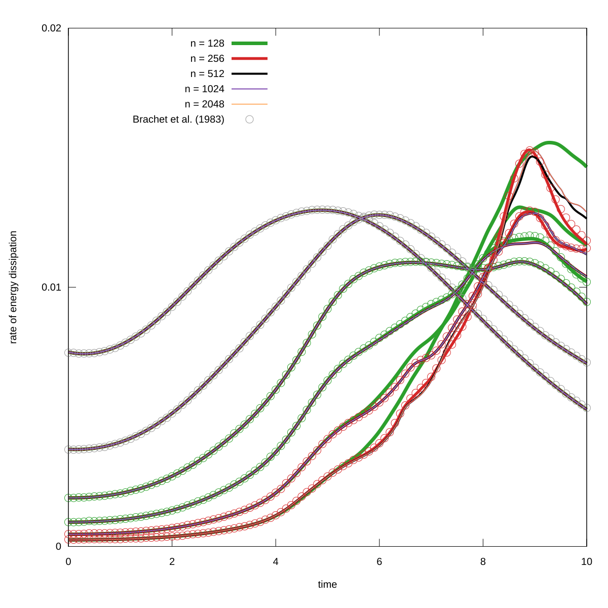
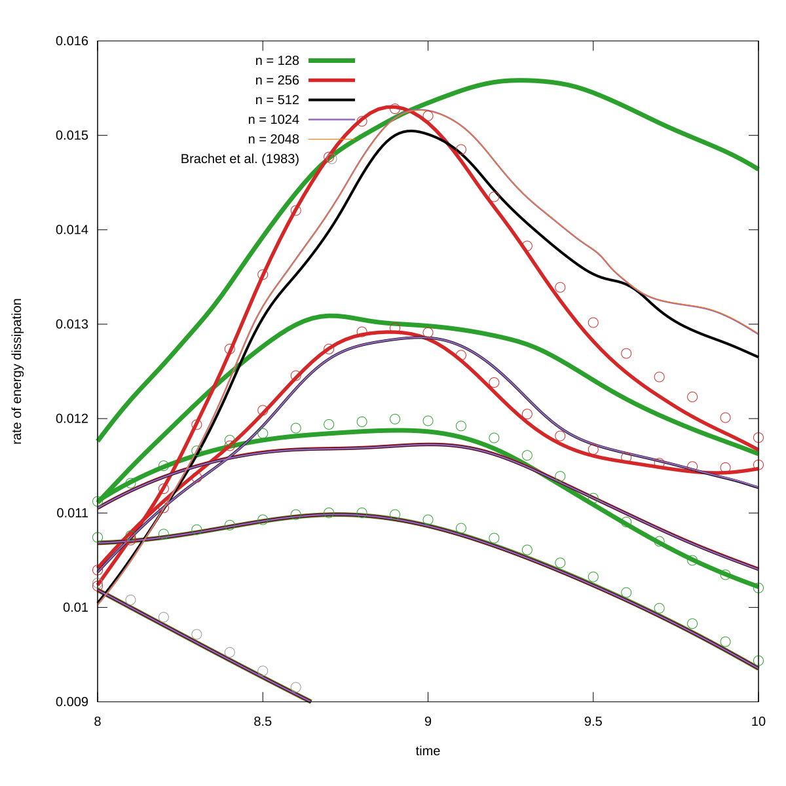
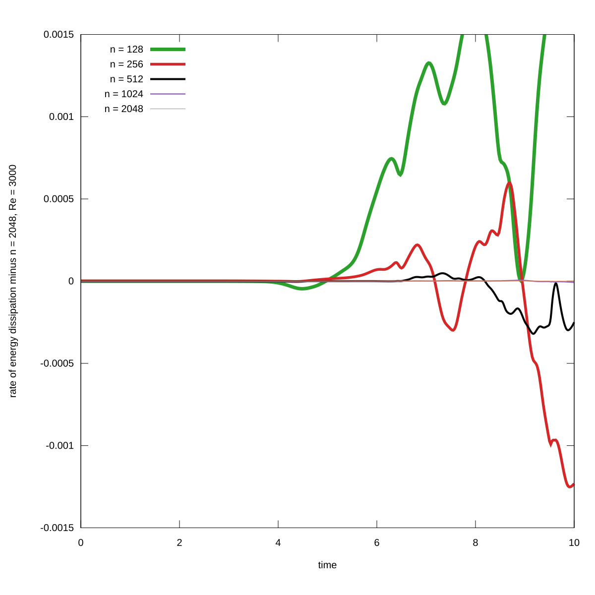
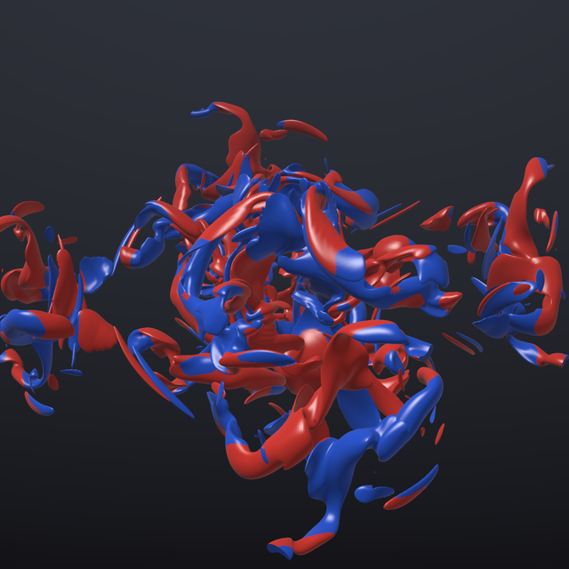

<h2>Build</h2>

Pseudo-spectral solvers for incompressible flow in a periodic box:
`fourier.c` (complex Fourier series, RK4) and `tg.c` (the Taylor-Green
vortex in the symmetric representation of Brachet et al., leapfrog
and Crank-Nicolson). Both print step, time, energy, and enstrophy.
Needs FFTW 3.3.9 or newer.
<pre>
$ make
$ ./tgv.py -l 6 -o tgv.raw
$ ./fourier -i tgv.raw -t 10 -n 0.01 -s 0.01
$ ./tg -M 32 -t 10 -n 0.01 -s 0.01
</pre>

```
Usage: fourier [-v] [-d] -i <input.raw> -n <viscosity> -t <end time> -s <time step>
Usage: tg -M <modes> -n <viscosity> -t <end time> -s <time step> [-e <spectrum interval>]
```

`tg -M 128` runs on a 256^3 grid.

<h3>Validation</h2>

<p align="center"></p>
Figure: Energy dissipation rate vs. time for the Taylor-Green vortex,
`tg` on n^3 grids (lines, `data/tg/<n>/<Re>`), and figure 7 of
Brachet et al. (circles, `img/ref.txt`). From top to bottom at time =
0: Re = 100, 200, 400, 800, 1600, 3000. The circles have the colour of
the grid used in the paper, grey where it is not stated.

<p align="center"></p>
Figure: The same, time = 8..10.

<p align="center"></p>
Figure: Difference from n = 2048 for Re = 3000.

At Re = 1600, `tg` on 512^3 and 1024^3 matches the 512^3 spectral
reference of the High-Order CFD Workshop
(`data/ref/spectral_Re1600_512.gdiag`: time, energy, dissipation rate,
enstrophy) to 3e-4 in the dissipation rate and 1e-5 in the energy.

<h3>In-situ rendering</h2>

`gpu/tgr.cu` is `gpu/tg.cu` with an isosurface renderer of |omega|
running on the GPU between time steps (`gpu/render.h`). Every `-r`
time units it synthesizes omega and its nine derivatives from the
spectral coefficients, fills the box [0,pi]^3 from the even and odd
classes using the mirror signs, stores f = |omega|^2 and grad f =
2 (grad omega)^T omega on (M+1)^3 nodes, and ray casts f = iso into a
PPM frame. The surface uses sum_q w_q (f_q + 1/2 g_q . (p - x_q)),
which is exact for quadratic f, so thin sheets keep their ridges;
normals come from a tricubic B-spline of the spectral gradient.
Colour: red where omega_z > 0, blue where omega_z < 0.

<pre>
$ make -C gpu tgr rview
$ ./gpu/tgr -M 256 -n 6.25e-4 -s 0.0025 -t 10 -r 0.05 -I 15 -a 0.5
</pre>

```
-r <interval>  render every interval time units, frames r.<step>.ppm
-I <level>     surface |omega| = level (or -i <fraction> of max|omega|)
-W <pixels>    image size, -S <n> n x n samples per pixel (3)
-o 0|1         ambient occlusion, -a <deg> camera turn per frame
-v 1           also dump the volume v.<step>.raw for gpu/rview
-c 1           compare f and grad f with the analytic field at t = 0
```

On an A100 MIG 3g.20gb slice at M = 256 a step takes 19 ms and a
1024^2 frame 210 ms (49 ms fields, 160 ms ray casting with 3 x 3
samples and occlusion; 55 ms with `-S 1 -o 0`). At t = 0 f and grad
f match the analytic Taylor-Green field to 1e-7 (float32 storage).

<p align="center"></p>
Figure: Re = 1600, 512^3 grid, t = 9, surface |omega| = 15.

<h2>References</h2>

- Brachet, M. E., Meiron, D. I., Orszag, S. A., Nickel, B. G., Morf,
  R. H., & Frisch, U. (1983). Small-scale structure of the
  Taylor-Green vortex. Journal of Fluid Mechanics, 130, 411-452.

- Orszag, S. A., & Patterson Jr, G. S. (1972). Numerical simulation of
  three-dimensional homogeneous isotropic turbulence. Physical review
  letters, 28(2), 76.

- Mortensen, M. (2016). Massively parallel implementation in Python of
  a pseudo-spectral DNS code for turbulent flows. arXiv preprint
  arXiv:1607.00850.

- High-Order CFD Workshop, test case: Taylor-Green vortex at Re = 1600,
  spectral reference data, 512^3,
  https://cfd.ku.edu/hiocfd/spectral_Re1600_512.gdiag
